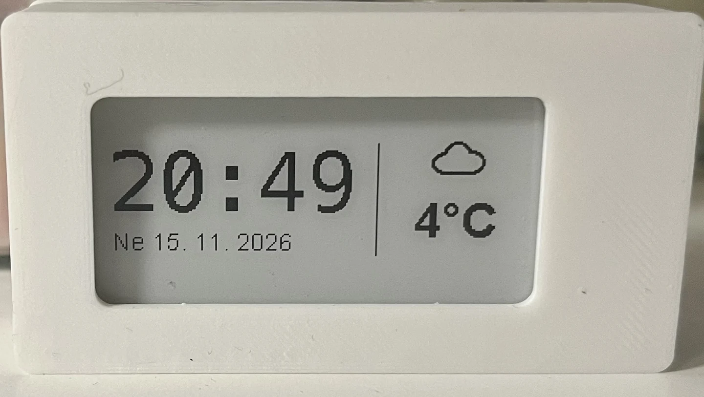
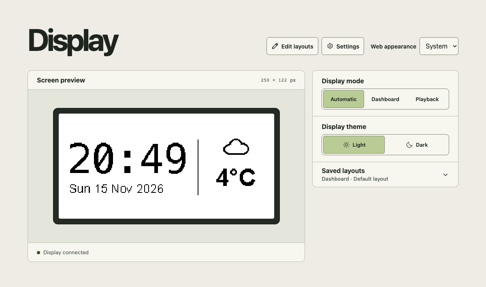
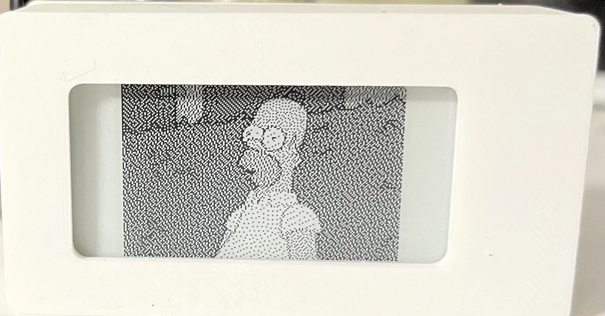
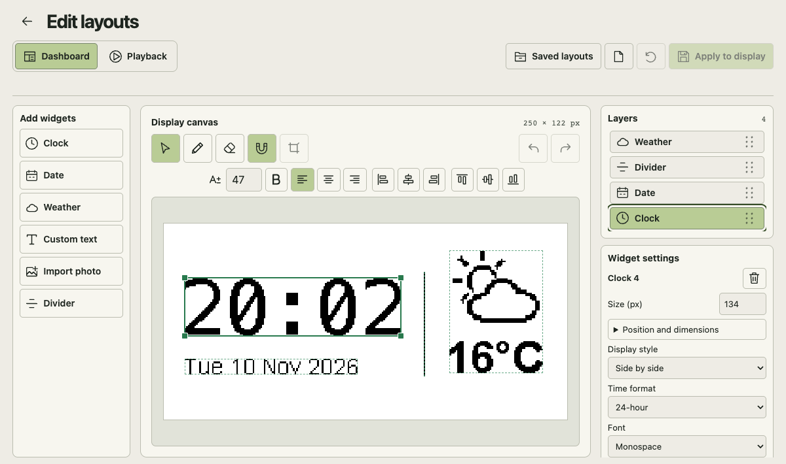
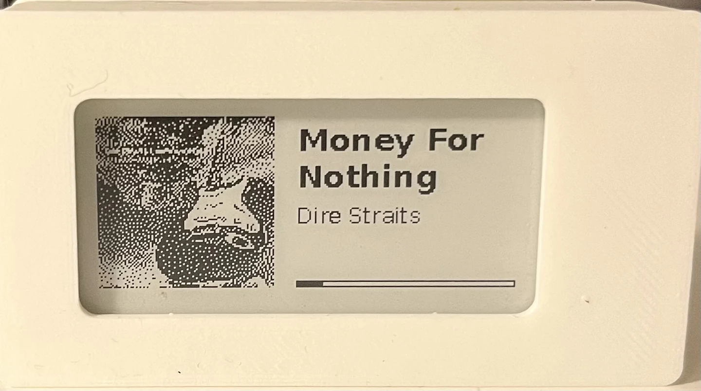
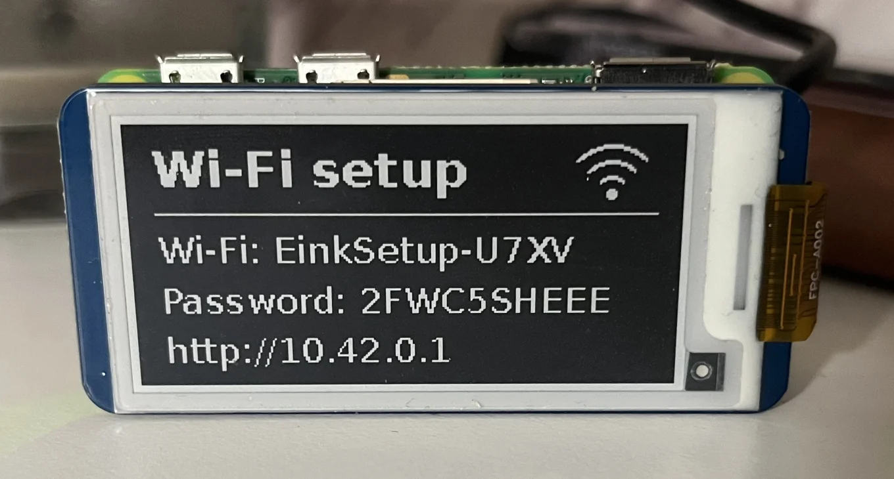

# E-ink Dashboard

A small desk display for the time, weather, and the track playing on Spotify. Put it in a 3D-printed case, arrange the screen in your browser, or leave a favourite photo on it as a digital picture frame.



[Parts and enclosure](#parts-and-enclosure) · [Install](#install) · [Use the dashboard](#use-the-dashboard) · [How it works](docs/how-it-works.md)

## Parts and enclosure

| Part | What to get |
| --- | --- |
| Raspberry Pi | [Raspberry Pi Zero 2 W](https://www.raspberrypi.com/products/raspberry-pi-zero-2-w/). Fit a 40-pin header if you plan to mount the HAT directly. |
| Display | [Waveshare 2.13-inch e-Paper HAT](https://www.waveshare.com/2.13inch-e-Paper-HAT.htm), black and white, 250 × 122 px. Check for the [V4 panel](https://files.waveshare.com/upload/4/4e/2.13inch_e-Paper_V4_Specification.pdf). |
| Storage and power | A microSD card for Raspberry Pi OS and a [micro-USB power supply](https://www.raspberrypi.com/products/micro-usb-power-supply/). |
| Enclosure | [Download the printable STL](hardware/eink-box.stl). Have a small cable tie and tie mount or a cable clamp ready for assembly. |

I tested the dashboard on the Waveshare 2.13-inch V4 panel (250 × 122 px). The layout editor and renderer adapt to other resolutions using the width and height in **Settings → Display**. To use a different physical panel, adapt the driver and native dimensions for that model.

### Print and assemble

The [enclosure STL](hardware/eink-box.stl) contains both pieces in their print orientation. Drop them onto the build plate at **100% scale** with **supports turned off**.

1. With the power supply unplugged, feed a standard USB power cable through the rear opening, micro-USB end first.
2. Plug the cable into the Pi's **PWR IN** port, then place the Pi and display in the case.
3. Secure the **outer cable jacket** to the case with a cable tie and mount or a small clamp. Leave a little slack inside so a tug on the cable pulls against the case. If you solder a permanent cable, insulate the joints and keep that slack between the anchor and the solder joints.

### Connect the display

Fit the HAT directly onto the Pi's 40-pin header, or use the eight-wire display cable. Match signal names using the table. [Waveshare manual](https://www.waveshare.com/wiki/2.13inch_e-Paper_HAT_Manual)

<details>
<summary>Eight-wire display pinout</summary>

| Waveshare | Raspberry Pi signal | Physical pin |
| --- | --- | ---: |
| VCC | 3.3 V | 1 |
| GND | GND | 6 |
| DIN | GPIO 10 (MOSI) | 19 |
| CLK | GPIO 11 (SCLK) | 23 |
| CS | GPIO 8 (CE0) | 24 |
| DC | GPIO 25 | 22 |
| RST | GPIO 17 | 11 |
| BUSY | GPIO 24 | 18 |

</details>

## Install

1. Use [Raspberry Pi Imager](https://www.raspberrypi.com/software/) to put Raspberry Pi OS on the microSD card. Configure Wi-Fi and SSH in Imager.
2. Boot the Pi with the display connected. Sign in over SSH and run this from your regular Pi user account.

   ```sh
   cd "$HOME" &&
     wget -O eink-dashboard-main.zip https://github.com/Anteikul/eink-dashboard/archive/refs/heads/main.zip &&
     python3 -m zipfile -e eink-dashboard-main.zip . &&
     sh eink-dashboard-main/install.sh
   ```

3. From the same network, open [eink.local](http://eink.local/) or the address printed by the installer. Settings and the layout editor open without a setup code.

The installer starts the dashboard and enables it on boot. Leave the installation folder in place. To restrict access to Settings and the layout editor, save a password under **Settings → Web password**, then turn on password protection.

## Use the dashboard



- **Automatic** follows Spotify when automatic switching is enabled. **Dashboard** keeps your chosen layout on screen. **Playback** keeps the music layout open even when Spotify is idle.
- **Display theme** changes the e-paper panel. **Web appearance** changes the browser interface.
- **Settings** lets you choose English or Czech, set the location and time zone, and rotate the display. The built-in layouts work in landscape and portrait. Use **Save configuration** to apply changes.

### Make it a picture frame



Open **Edit layouts → Dashboard → Start blank**. Import a photo or illustration, crop and resize it to fill the canvas, then choose **Apply to display**. On the main page, select **Dashboard** to keep that image on screen. The e-paper panel holds the last image even after you shut down the Pi and unplug it. [Waveshare display details](https://www.waveshare.com/2.13inch-e-Paper-HAT.htm)

### Build your own layout



Mix clocks, dates, weather, text, photos, and album art. Drag widgets onto the canvas, reorder them under **Layers**, or sketch with **Draw**. **Saved layouts** keeps reusable designs for Dashboard and Playback separately. **Apply to display** puts the current design on the panel.

<details>
<summary>Photo formats and editor shortcuts</summary>

- Import JPEG, PNG, HEIC/HEIF, WebP, GIF, BMP, or TIFF up to 16 MB. Use **Crop photo** to adjust framing. Photos are converted to black and white at the panel's resolution.
- Hold **Shift** while resizing to adjust width and height independently. Use **Snap** to align edges and centres, or open **Position and dimensions** for pixel-level control.
- Double-click custom text to edit it on the canvas. Press **Shift+Enter** for a new line and **Enter** to finish, both on the canvas and in the text field on the right. Custom text grows beyond its initial box without adding an ellipsis, up to the edge of the display. The Wrapped variant continues onto new rows; Single line grows horizontally and also keeps manual line breaks. Use **Ctrl+Z** and **Ctrl+Shift+Z** to undo and redo, or **⌘Z** and **⌘⇧Z** on Mac.

</details>

### Connect Spotify



1. Create an app that uses **Web API** in the [Spotify Developer Dashboard](https://developer.spotify.com/dashboard). Add `http://127.0.0.1:8765/callback` as a redirect URI. The app owner needs Premium in [Development Mode](https://developer.spotify.com/documentation/web-api/concepts/quota-modes).
2. In **Settings → Spotify**, enter the **Client ID** and choose **Connect Spotify**. The permission page opens in a new tab or window. Use the link under the form if your browser blocks it.
3. Copy the full redirect URL from the browser's address bar, even if the page at `127.0.0.1` shows a connection error. Paste it into **Redirect URL** and choose **Finish connecting**.

## Local by default

The Raspberry Pi hosts the interface, renders the display, and processes and stores your photos, layouts, and settings locally. Connecting Spotify uses its API for playback and album art. Weather and city search use [Open-Meteo](https://open-meteo.com/), and update checks contact GitHub.

## Updates and troubleshooting

- **Settings → Updates** checks GitHub for updates. If a new version fails to start, the Pi returns to the previous version.
- If `eink.local` does not resolve, use the Pi's IP address.
- In the installation folder, run `tail -f dashboard.log` for startup and refresh messages or `./install.sh --check` to check dependencies. Use `./start.sh` to start the dashboard manually when it is stopped.

<details>
<summary>Optional Wi-Fi setup hotspot</summary>



From the installation folder, run `sh install.sh --wifi-setup`. If the Pi cannot join a saved network, join the **EinkSetup** hotspot using the name and password shown on your own display. Open `http://10.42.0.1/` and enter the details for your 2.4 GHz network. The display shows the new address when the Pi connects.

In **Settings → Wi-Fi setup**, refresh the nearby networks, connect using a password, reconnect to a saved network, or forget a saved connection. Choose **Saved networks** to reuse a stored password; nearby rows always ask for connection details so networks with the same name cannot select the wrong saved profile. Saved networks remain listed when out of range. Switching networks or forgetting the current network can disconnect the page; join the Pi's network and reopen the address shown on its display. New connections support open networks and WPA personal security; other security types require an existing NetworkManager profile. Profiles for another adapter and profiles using advanced NetworkManager `match` rules are excluded.

If upgrading an existing installation, run `sh install.sh --wifi-setup` once from the updated installation folder, then restart the Pi. This also updates the restricted Wi-Fi helper; the web update alone cannot replace that root-owned component. Until it is updated, Settings can show networks but disables connecting and forgetting them.

</details>

## License

The project is released under the [MIT License](LICENSE). The [Waveshare driver](waveshare_epd/epd2in13_V4.py) retains its original license notice.

## Contributing

Feel free to contribute. For a bug or idea, [open an issue](https://github.com/Anteikul/eink-dashboard/issues/new). To send a change, fork the repo, make and test your change on a new branch, then open a pull request with a short description and screenshots for UI changes.
