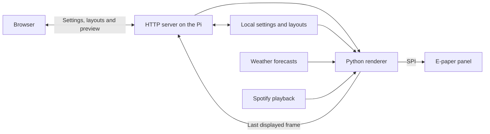

# How E-ink Dashboard works

The Raspberry Pi runs a Python process that serves the dashboard over your local network and drives the Waveshare e-paper panel over SPI. Your browser is the control surface. Close it and the Pi keeps updating the display.



## Start and connect

[The installer](../install.sh) prepares Raspberry Pi OS and configures startup at boot. [`start.sh`](../start.sh) finds the local IPv4 address and starts the dashboard under the [update supervisor](../updates.py). [`local_name.py`](../local_name.py) advertises the configured `.local` name on the local network.

With optional Wi-Fi setup enabled, [`wifi_setup.py`](../wifi_setup.py) waits for a known network. If none connects within the configured delay, it starts a temporary hotspot and shows the connection details on the panel. The web server serves the Wi-Fi form at `10.42.0.1`. A local systemd socket passes network changes to a helper that talks to NetworkManager. After a successful join, the dashboard switches to the Pi's new address.

## Browser, layouts and photos

[`control.py`](../control.py) serves the [HTML, CSS and JavaScript](../web/) and handles requests from the dashboard, settings and layout editor. The main page reads `/api/state` and displays the Pi's latest published frame from `/screen.png`. Web appearance is stored in the browser. The panel's light or dark theme is stored on the Pi.

The editor sends widget layouts to the Pi for validation and preview. [`layout_editor.py`](../layout_editor.py) defines widget types, their positions and sizes, and how they render. Applying a layout puts it on the chosen screen. Saving a named layout adds it to the reusable library for either Dashboard or Playback.

For a photo, [`photo_import.py`](../photo_import.py) decodes the upload and returns grayscale pixels for cropping in the browser. [`photo-crop.js`](../web/photo-crop.js) handles the crop. The saved layout contains the image data used to render that widget. Photos and layouts stay between your browser and the Pi.

## From widgets to pixels

1. [`dashboard.py`](../dashboard.py) chooses a screen based on the selected display mode and whether Spotify is playing. It gathers the current clock, weather and playback values and skips the render when the visible content is unchanged.
2. The renderer draws the built-in screen or custom widgets as black-and-white pixels. It fits the result to the display, accounts for rotation, and packs it for the panel's native 250 × 122 resolution.
3. [`panel.py`](../panel.py) and the [Waveshare driver](../waveshare_epd/epd2in13_V4.py) send the frame to the panel. Partial updates send only changed regions. Full refreshes run when switching screens, changing themes, or after a series of partial updates to clear ghosting.
4. The server publishes a PNG of the displayed frame for the browser preview. E-paper holds that image when power is disconnected.

## Online integrations

- **Weather.** The Pi fetches forecasts from Open-Meteo using the configured coordinates. City search uses the Open-Meteo geocoding API. Turn off **Show weather** in Settings to stop forecast polling.
- **Spotify.** [`device_settings.py`](../device_settings.py) starts an OAuth authorization flow using PKCE. After you paste the redirect URL into Settings, the Pi exchanges the authorization code for tokens. [`spotify_playback.py`](../spotify_playback.py) polls Spotify and estimates progress between requests. [`music_screen.py`](../music_screen.py) prepares and caches black-and-white album art.
- **Updates.** [`updates.py`](../updates.py) checks GitHub for a newer version. When you choose to install it, the supervisor stages the new code separately, starts it, and waits for its first successful panel update. If startup fails, it returns to the previous version. Both versions use the same local data folder.

## Local data

| File or folder | What it contains |
| --- | --- |
| `.settings.json` | Device settings, including language, location, rotation and refresh intervals |
| `.layouts.json` and `.layout-library.json` | Applied layouts and saved designs |
| `theme.txt` and `display-mode.txt` | Panel theme and display mode |
| `.spotify.json` and `.cover-cache/` | Spotify refresh credentials and processed album art |
| `.setup-code` and `.web-session-key` | Optional web password and the key used to sign browser sessions |
| `.updates/` and `dashboard.log` | Staged versions and startup or refresh logs |

Fresh installations open Settings and the layout editor directly on the local network. When web password protection is enabled, those pages and their APIs require authentication.

## Check a change

The [`checks/`](../checks/) scripts exercise rendering, rotation, layout editing, Spotify polling, HTTP settings, Wi-Fi and update recovery. From the project directory with the Python dependencies installed, run the checks with:

```sh
export PYTHONPATH=.
for check in checks/check*.py; do
    python3 "$check" || exit
done
```

[Back to the README](../README.md)
